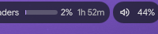

# Shader Progress

Steam's shader processing as an animated progress bar in your [DankBar](https://github.com/AvengeMedia/DankMaterialShell), hidden while nothing is compiling.



Sibling of [GPU Monitor](https://github.com/rollecode/dms-gpu-monitor), [VRAM Monitor](https://github.com/rollecode/dms-vram-monitor) and [CPU Monitor](https://github.com/rollecode/dms-cpu-monitor).

## What it does

- Compact bar pill: icon, optional label, animated progress bar and percentage
- While Steam processes Vulkan shaders in the background, shows progress from the compiled and remaining counts in its shader log, plus an estimate of the time left
- Steam's own percentage barely moves during a long run, so the widget does not use it
- The time left comes from how fast the remaining count fell over the last ten minutes, and shows after the first minute
- While a game running through DXVK compiles shaders, shows how much CPU the compiler threads use instead, in orange: the game stutters while this is high
- Real CPU use from the threads' CPU time between polls, not a lifetime average
- Hides itself when Steam is not processing and no game is compiling
- Click the pill for the game name and the raw counts
- Zero dependencies

## Requirements

- Steam installed in `~/.local/share/Steam`
- Proton or DXVK for the in-game part

## Installation

```bash
git clone https://github.com/rollecode/dms-shader-progress ~/.config/DankMaterialShell/plugins/shaderProgress
```

Then enable it in Settings, Plugins, and add the widget to your bar layout in Settings, Bar.

## Settings

- **Show label**: toggle the text label next to the icon (on by default)
- **Label text**: customize the label (default `Shaders`)
- **Update interval**: seconds between reads, 1 to 10 (default 2)

## License

MIT
